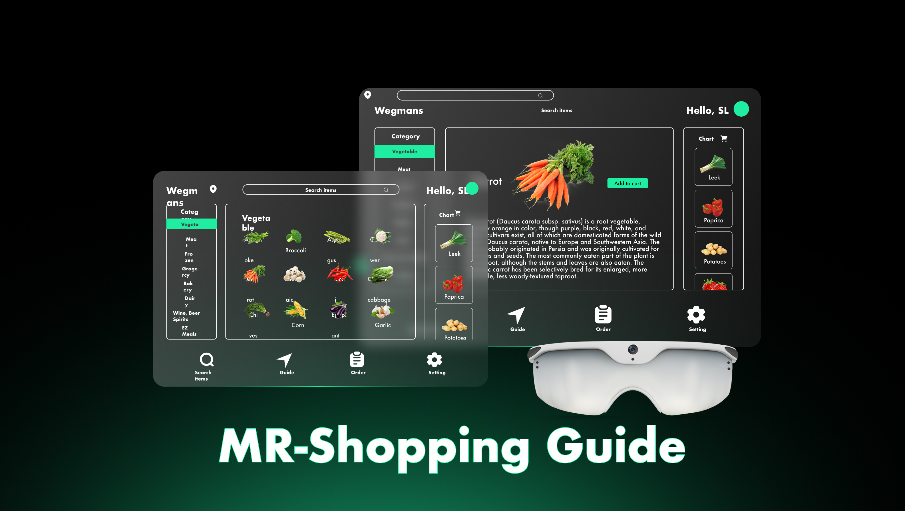
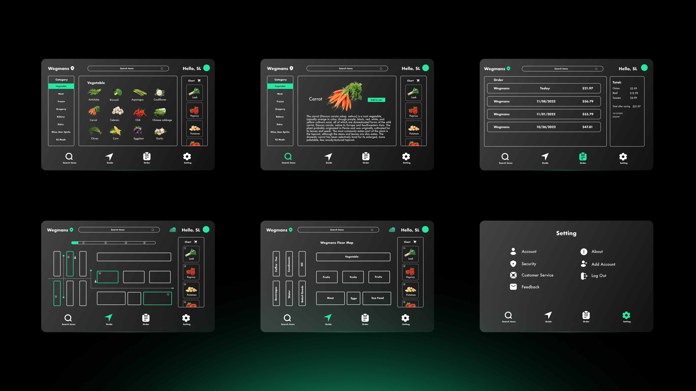
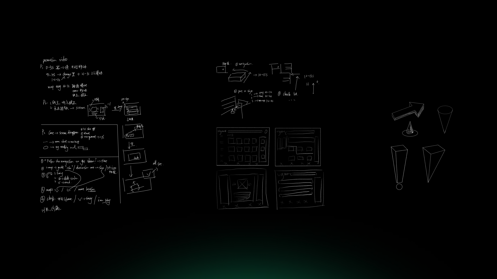

## Design

  <figure>
    <video src="Clip/menu.mp4" autoplay muted loop playsinline></video>
    <figcaption>Adding items</figcaption>
  </figure>
  <figure>
    <video src="Clip/navigation.mp4" autoplay muted loop playsinline></video>
    <figcaption>Navigation</figcaption>
  </figure>

  <figure>
    <video src="Clip/PutSign.mp4" autoplay muted loop playsinline></video>
    <figcaption>Sign</figcaption>
  </figure>
  <figure>
    <video src="Clip/Thanku.mp4" autoplay muted loop playsinline></video>
    <figcaption>Check out</figcaption>
  </figure>

## UI

## Sketch

