---
# Copy this whole folder to start a new project, rename the folder (it becomes the URL),
# then replace the images and text.
# A folder name starting with "_" (like this one) is a DRAFT: visible while running
# `npm run dev`, left out of the live site. Remove the "_" when it is ready to publish.
title: "Beyond the Known"
category:  3d-motion                # mr | ux | 3d-motion  (see content/design-categories.yml)
type: "3d-motion"          # small label above the title on the card
summary: "An experimental animation reflecting on humanity's fragility in the face of nature and our enduring curiosity to explore the unknown."
cover: "image.png"           # card image: .png / .jpg / .gif / .webp, or a .mp4 (plays silently on loop)
year: 2022                   # optional — shown under the title
# role: "UX Researcher, Designer"
tools: "Figma, Cinema 4D, After Effects, X-Particles"
order: 0                     # smaller = earlier in its category
---

## Video

<iframe src="https://www.youtube.com/embed/gUejl_kdHw0" allowfullscreen></iframe>

## Frames

  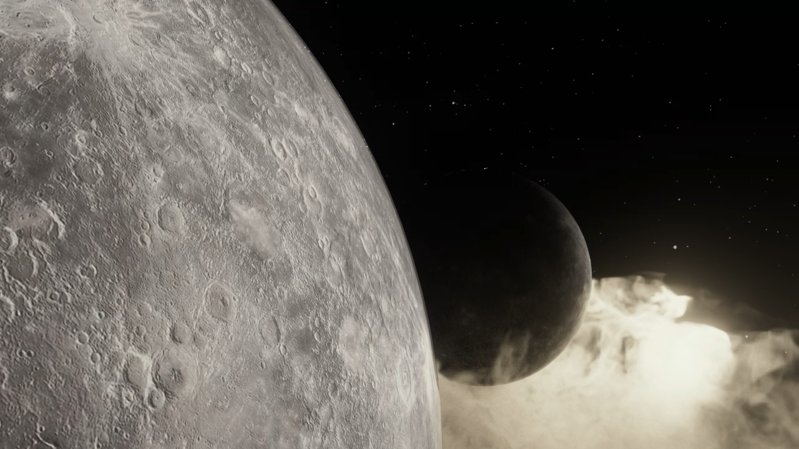
  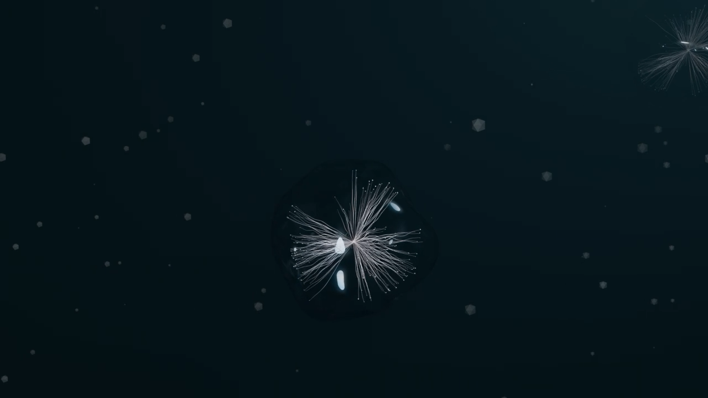
  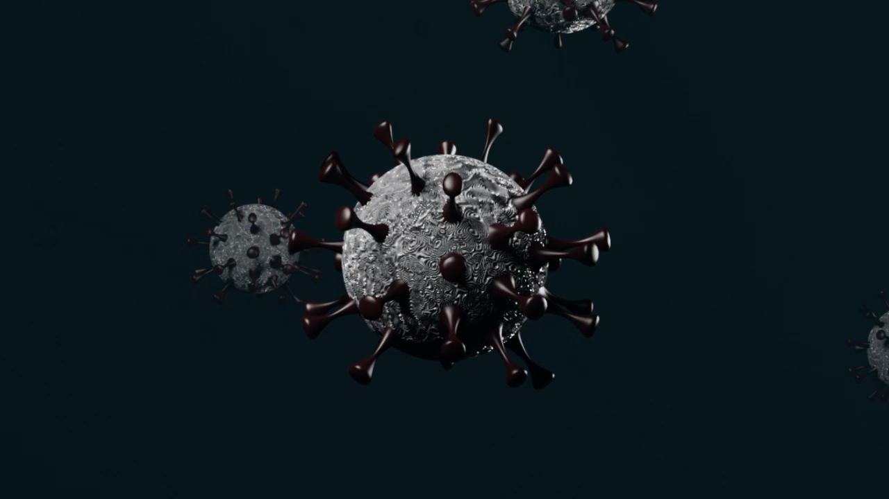
  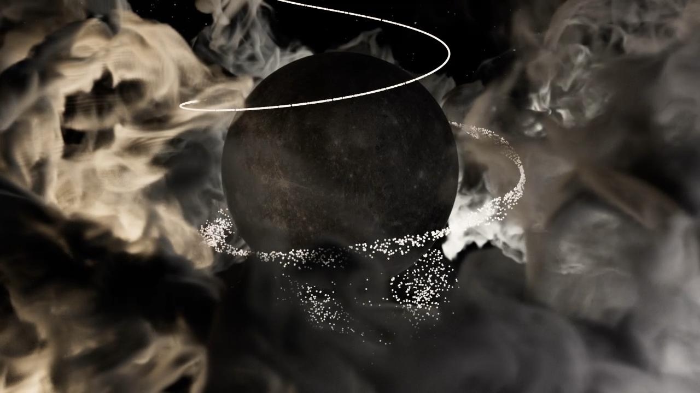
  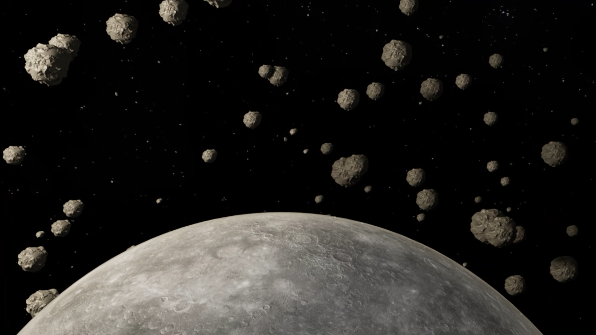
  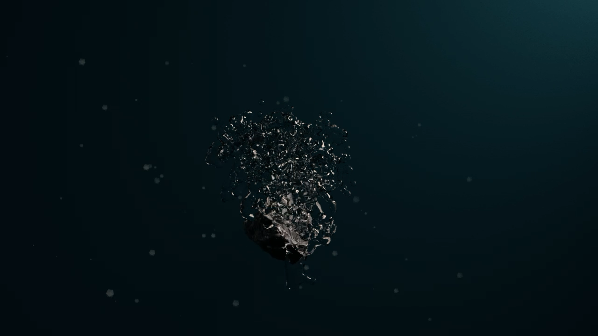

## Animation & Lighting Breakdown

  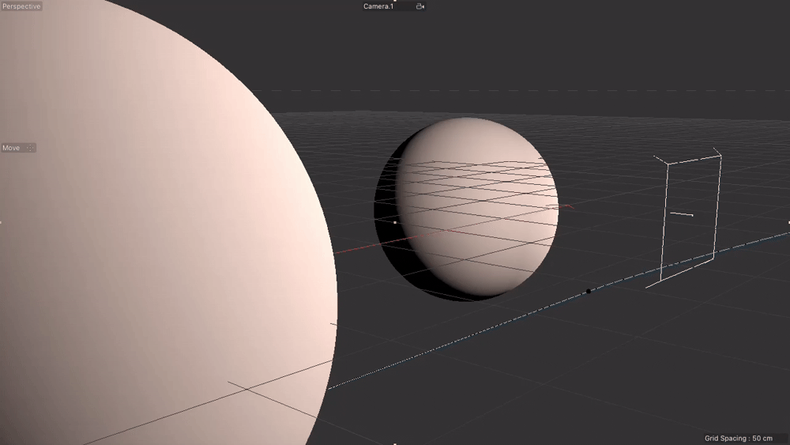
  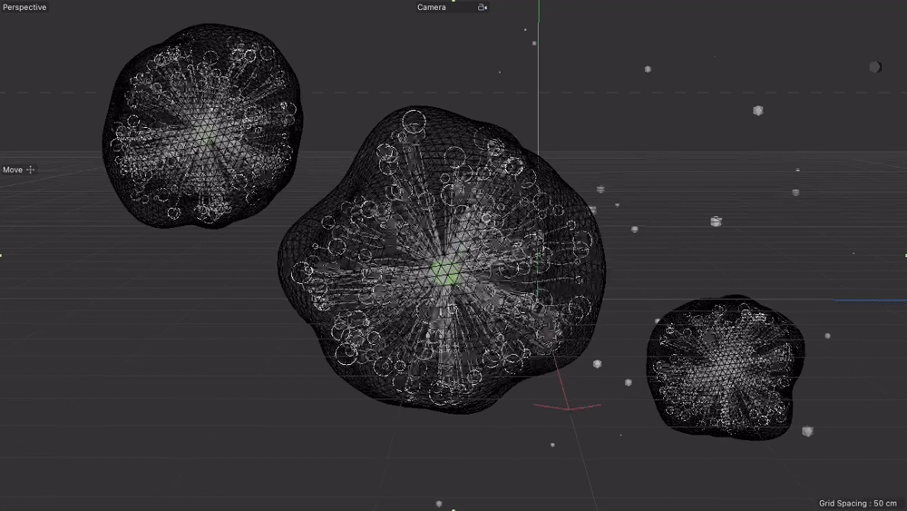
  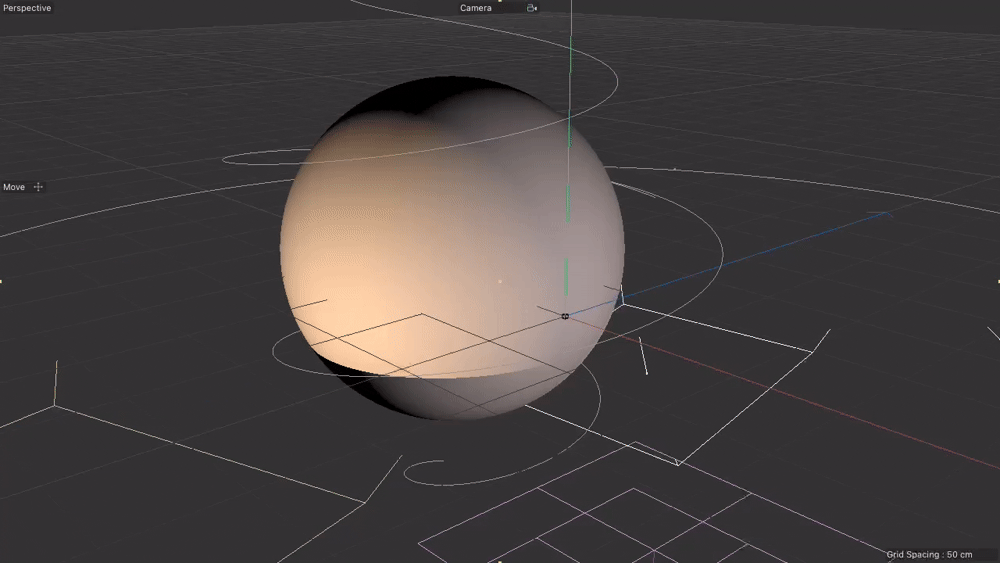
  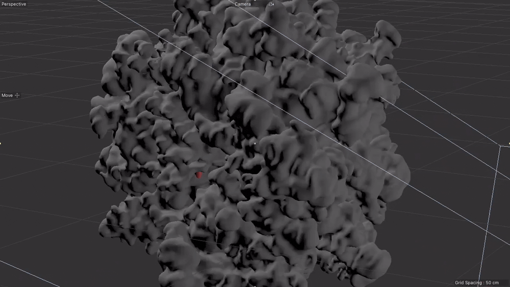
  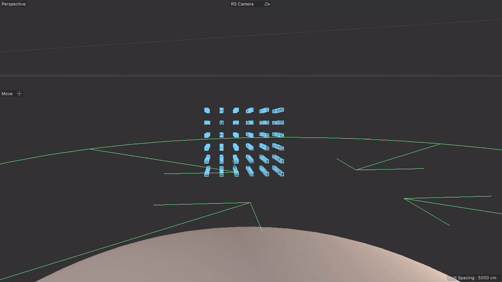
  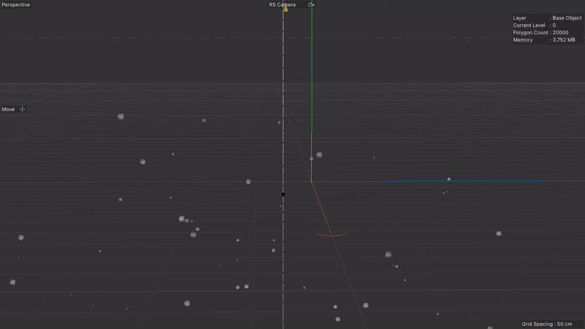

## Sketch

