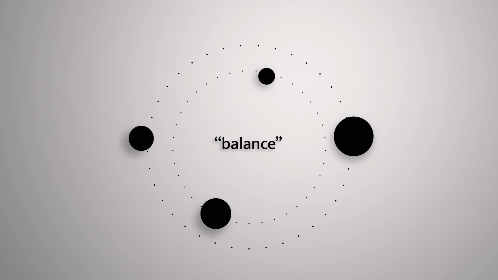
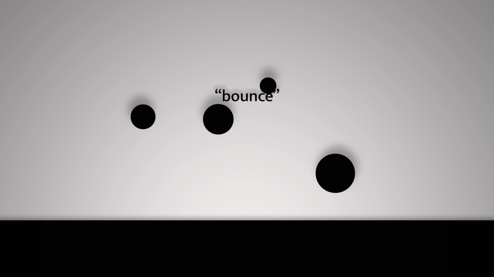
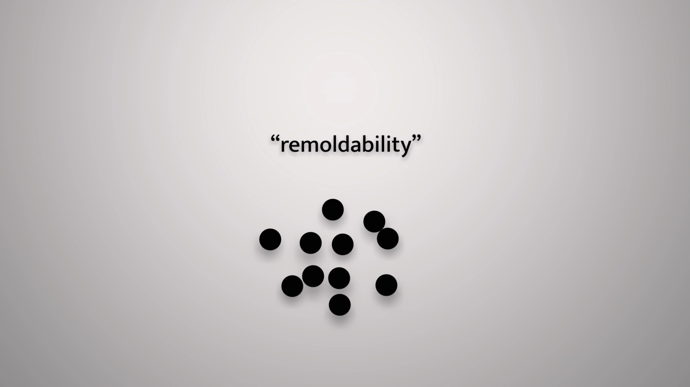
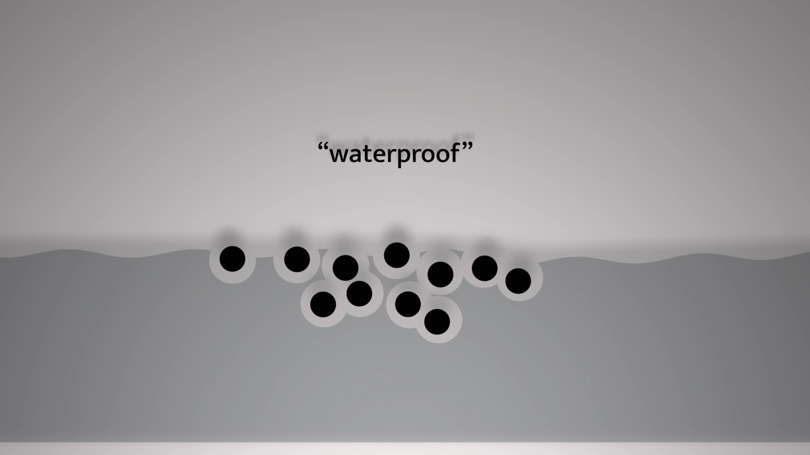
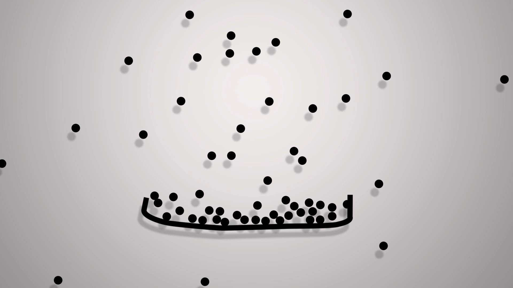
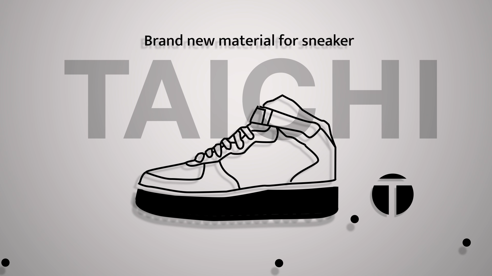

---
# Copy this whole folder to start a new project, rename the folder (it becomes the URL),
# then replace the images and text.
# A folder name starting with "_" (like this one) is a DRAFT: visible while running
# `npm run dev`, left out of the live site. Remove the "_" when it is ready to publish.
title: "TAICHI"
category: 3d-motion                  # mr | ux | 3d-motion  (see content/design-categories.yml)
type: "Motion"          # small label above the title on the card
summary: "An experimental motion graphics piece introducing TAICHI, an innovative sneaker material."
cover: "image2.png"           # card image: .png / .jpg / .gif / .webp, or a .mp4 (plays silently on loop)
year: 2022                   # optional — shown under the title
# role: "UX Researcher, Designer"
tools: "Figma, After Effects"
order: 0                     # smaller = earlier in its category
---

## Video

<iframe width="560" height="315" src="https://www.youtube.com/embed/inE7uwiHylo?si=p9i4Z3QQ5H-F1JGg" title="YouTube video player" frameborder="0" allow="accelerometer; autoplay; clipboard-write; encrypted-media; gyroscope; picture-in-picture; web-share" referrerpolicy="strict-origin-when-cross-origin" allowfullscreen></iframe>

## Frames

  
  
  
  
  
  

## Sketch

