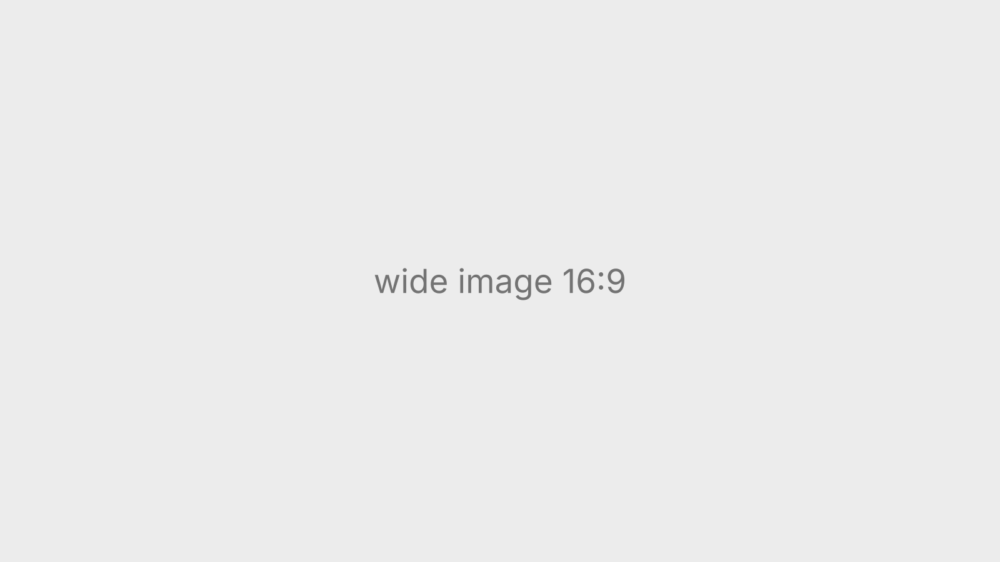
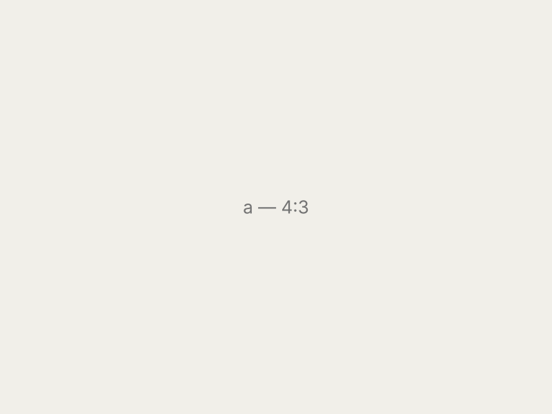
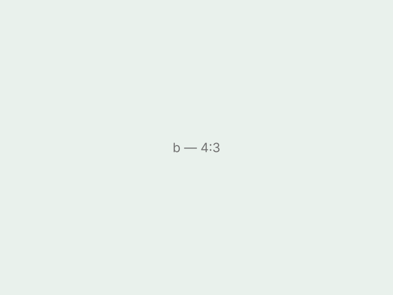
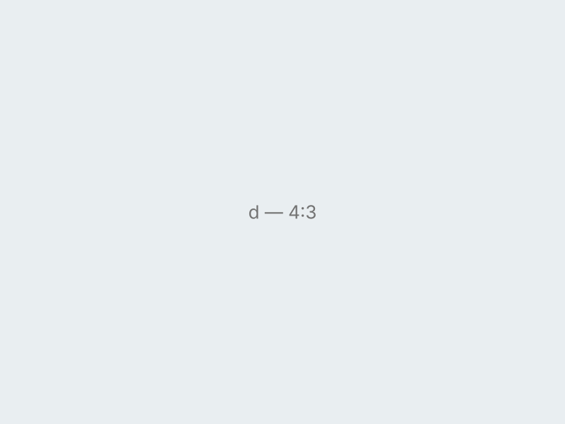
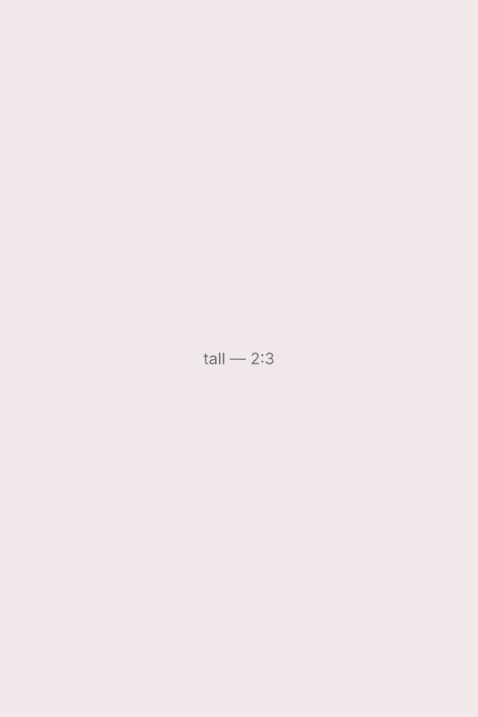

---
# ════════════════════════════════════════════════════════════════════════
#  作品页模版（完整版）
#  用法：复制整个 _template 文件夹 → 改名（去掉开头的 _，名字会成为网址）
#        → 把 media/ 里的占位图换成你的图片和视频 → 修改下面的设置和正文
#  文件夹名以 _ 开头 = 草稿：只在本地 npm run dev 能看到，线上不会出现
#  本地预览这个模版：http://localhost:5173/design/ux/template
# ════════════════════════════════════════════════════════════════════════

title: "Project Title"            # 作品标题（卡片和详情页顶部）
category: ux                      # 放在哪个版块：mr | ux | 3d-motion（见 content/design-categories.yml）
type: "UX Research"               # 标题上方的小字标签（可选）
summary: "One-sentence description of the project."   # 卡片上的一句话简介（卡片只显示一行）+ 详情页标题下的简介
cover: "media/cover.svg"          # 卡片封面，16:9 显示（会裁切到 16:9）
                                  #   图片：.jpg .png .webp .gif（GIF 会动）
                                  #   视频：.mp4 .webm（自动静音循环播放）
year: 2026                        # 可选：详情页顶部 YEAR
role: "Designer, Researcher"      # 可选：详情页顶部 ROLE
tools: "Figma, Unity, Maya"       # 可选：详情页顶部 TOOLS
order: 0                          # 在版块里的顺序，数字小的在前
---

<!--
═══════════════════════════════════════════════════════════════════════════
  写正文之前要知道的 4 条规则
  1. 文件路径：写相对于本文件夹的路径，例如 "media/a.jpg"、"Clip/menu.mp4"
  2. 
 / <figure> 这种块的内部【不要留空行】，空行会把块截断
  3. HTML 块里面不能用 markdown 语法（比如 **粗体**），要用 <strong>粗体</strong>
  4. 一行开头不要缩进 4 个空格以上（会变成代码块），块内部的缩进没关系
  这种灰色的注释块在网页上看不见，可以随便保留或删除
═══════════════════════════════════════════════════════════════════════════
-->

## 1. 文字

普通段落直接写。可以用 **粗体**、*斜体*、[链接](https://example.com)（外部链接会在新标签页打开）。正文最宽 720px，图片和视频最宽约 1000px（整栏）。

### 三级标题

#### 四级标题（小号大写灰字，适合做小节标签）

- 列表项
- 列表项

1. 有序列表
2. 有序列表

> 引用，适合放用户访谈原话。

### 文字的字号、颜色、粗细

<!--
  markdown 写的文字用的是网站默认样式（正文 15px 灰色）。想改样式，就用 HTML 写，设置放在 style="…" 里：
    整段：
一段文字

    段落里的几个字：几个字
    标题：<h2 style="…">标题</h2>（h3、h4 也一样）

  style 里可以写的设置（用分号隔开，不需要的删掉）：
    font-size: 20px;          字号。网站默认：正文 15px、小字 13px、h2 20px、h3 16px、页面大标题 30px
    color: #171717;           颜色（可以写任意颜色代码）。网站常用色：
                                #171717 近黑（标题）  #525252 深灰（正文默认）
                                #737373 中灰          #a3a3a3 浅灰（说明文字）
                                #2563eb 蓝色（链接）
    font-weight: 600;         粗细：400 = 常规，500 = 中等，600 = 半粗，700 = 粗
    line-height: 1.6;         行高（行与行之间的距离）
    letter-spacing: 0.5px;    字间距
    font-style: italic;       斜体
    text-transform: uppercase;   英文全部大写
    text-align: center;       对齐：left / center / right
    max-width: none;          段落默认最宽 720px，写这个可以让它占满整栏
    margin-top: 40px;         和上一块内容之间的距离

  注意：
 这种 HTML 里不能用 markdown 语法，粗体要写 <strong>粗体</strong>，
        链接要写 <a href="https://…">链接</a>
-->

一句放大加粗的重点句子，适合做引言或结论。

普通段落里，可以把某几个字单独改颜色，或者单独放大。

<h2 style="font-size: 28px; color: #2563eb;">自定义颜色和大小的标题</h2>

居中的灰色小字说明

Section label

---

## 2. 单张图片

<!-- 最简单：整栏宽度。GIF 也是一样写 -->

<!--
  需要调整时用 ，所有设置写在 style="…" 里，用分号隔开，不需要的删掉即可：
    width: 60%;              宽度（相对整栏）。也可以写像素，如 600px
    max-width: 800px;        最大宽度（窄屏时还能缩小，比 width 更安全）
    margin: 0 auto;          居中（width 小于 100% 时才看得出来；也可以用 class="center"，见第 7 节）
                             margin: 上 左右 下 → 例：margin: 40px auto 0;（上方留 40px 并居中）
    border-radius: 12px;     圆角（默认 3px；0 = 直角）
    aspect-ratio: 16 / 9;    强制比例，搭配 object-fit 使用
    object-fit: cover;       cover = 裁切填满 / contain = 完整显示（会留边）
    object-position: top;    裁切时保留哪一部分：top / bottom / left / right / center
    box-shadow: 0 8px 30px rgba(0,0,0,0.12);   阴影
    background: transparent; 透明背景（PNG 有透明区域时用；默认是浅灰底）
-->

<!-- 例：把图片裁成 21:9 宽银幕，保留上半部分 -->

## 3. 带说明文字的图片 / 视频

<!--
  把图片或视频和 <figcaption> 一起放进 <figure>，说明文字会显示在下方（灰色小字、默认居中）
  <figcaption> 可调：
    style="text-align: left;"            说明文字靠左（right = 靠右）
    style="font-size: 14px; color: #525252;"   字号、颜色
  整个 <figure> 想缩小并调位置：给 <figure> 加 class 和 width（不是给里面的图片加）
    <figure class="center" style="width: 60%;">   ← 图和说明文字一起缩小、居中
-->
<figure>
  
  <figcaption>Figure 1. 图片的说明文字</figcaption>
</figure>

<!-- 视频 + 说明：<video> 的开关和第 5 节一样（这里是像 GIF 一样自动静音循环） -->
<figure>
  <video src="media/loop.mp4" autoplay muted loop playsinline></video>
  <figcaption>Video 1. 视频的说明文字</figcaption>
</figure>

<!--
  多个带说明的视频（或图片）并排：在 
 里放几个 <figure>
    放 2 个 = 两列，3 个 = 三列；手机上自动竖排
    想固定每行几个并自动换行，用 class="row cols-3"（见第 4 节）
    视频比例不一样时，给每个 <video> 加 style="aspect-ratio: 16 / 9; object-fit: cover;" 统一成一样大
-->

  <figure>
    <video src="media/loop.mp4" autoplay muted loop playsinline></video>
    <figcaption>Video A. 左边视频的说明</figcaption>
  </figure>
  <figure>
    <video src="media/loop.mp4" autoplay muted loop playsinline></video>
    <figcaption>Video B. 右边视频的说明</figcaption>
  </figure>

<!-- 带播放按钮的视频 + 靠左的说明，整体缩小到 60% 并居中 -->
<figure class="center" style="width: 60%;">
  <video src="media/loop.mp4" controls poster="media/poster.svg" preload="metadata"></video>
  <figcaption style="text-align: left;">Video 2. 缩小并居中，说明文字靠左</figcaption>
</figure>

<!-- 在线视频（YouTube 等）+ 说明，同样放进 <figure> -->
<figure>
  <iframe src="https://www.youtube.com/embed/gUejl_kdHw0" allowfullscreen></iframe>
  <figcaption>Video 3. YouTube 视频的说明文字</figcaption>
</figure>

## 4. 多张并排

<!--
  A. 自动等分：放几张就分几列（2 张 = 两列，3 张 = 三列…），手机上竖排
     默认会把同一行的图片裁成一样高；不想裁切就给每张 img 加 style="height: auto;"
-->

  
  

<!--
  B. 固定列数、自动换行（适合很多张图片的图集）：
     cols-2 → 每行 2 张（手机 1 张）
     cols-3 → 每行 3 张（手机 2 张）
     cols-4 → 每行 4 张（手机 2 张）
     间距：style="gap: 5px;"（默认 16px；0 = 无缝拼图）
-->

  
  
  
  
  
  

<!--
  C. 不等宽：grid-template-columns 里每个数字是一列的占比
     2fr 1fr = 左边占 2/3、右边占 1/3；1fr 1fr 1fr = 三等分
     align-items: center = 高度不同时垂直居中（start = 顶对齐 / end = 底对齐）
     （注意：用了 grid-template-columns 的行在手机上不会自动竖排）
     并排里的每一格也可以是 <figure>，这样每张图下面都有自己的说明
-->

  
  

## 5. 本地视频

<!--
  把视频放进文件夹（比如 media/ 或 Clip/），建议 mp4（H.264），单个文件 10MB 以内，最多不能超过 100MB
  <video> 的开关（直接写单词，不需要的删掉）：
    autoplay      自动播放（必须同时有 muted，浏览器才允许自动播放）
    muted         静音
    loop          循环
    playsinline   在 iPhone 上原地播放，不弹出全屏
    controls      显示播放 / 暂停 / 进度条 / 音量
    poster="media/poster.jpg"   播放前显示的封面图
    preload="metadata"          不立即下载整段视频（长视频建议加，网页打开更快）
  style 里的设置和图片完全一样：width / max-width / margin / border-radius / aspect-ratio / object-fit
-->

<!-- 像 GIF 一样：自动、静音、循环（适合 UI 动效、短演示） -->
<video src="media/loop.mp4" autoplay muted loop playsinline></video>

<!-- 普通视频：有播放按钮和封面图，不自动播放（适合有声音的讲解视频） -->
<video src="media/loop.mp4" controls poster="media/poster.svg" preload="metadata"></video>

<!-- 缩小并居中（例如 50% 宽）。只写 width 不写位置的话会靠左；靠左 / 靠右见第 7 节 -->
<video src="media/loop.mp4" class="center" autoplay muted loop playsinline style="width: 50%;"></video>

<!-- 视频和图片也可以混在一行里 -->

  <video src="media/loop.mp4" autoplay muted loop playsinline></video>
  

## 6. 在线视频（YouTube / Bilibili / Vimeo）

<!--
  默认 16:9、占满整栏。
  YouTube：在视频页点「分享 → 嵌入」，或者把网址里的 watch?v=ID 换成 embed/ID
    src 后面可以加参数（用 ? 开头，多个用 & 连接）：
      ?autoplay=1&mute=1          自动播放（必须静音）
      &loop=1&playlist=视频ID      循环（playlist 要再写一次同一个 ID）
      &controls=0                  隐藏控制条
      &start=30                    从第 30 秒开始
  竖屏视频（Shorts / 手机拍的）：style="aspect-ratio: 9 / 16; width: 360px; margin: 0 auto;"
-->
<!-- 例子用的是你 Particle 作品的视频 ID，换成自己的即可 -->
<iframe src="https://www.youtube.com/embed/gUejl_kdHw0" allowfullscreen></iframe>

<!--
Bilibili（把 BV 号换成你的；autoplay=0 = 不自动播放）：
<iframe src="https://player.bilibili.com/player.html?bvid=BV1xxxxxxxxx&autoplay=0" allowfullscreen></iframe>

Vimeo：
<iframe src="https://player.vimeo.com/video/VIDEO_ID" allowfullscreen></iframe>
-->

## 7. 位置（靠左 / 居中 / 靠右）

<!--
  图片和视频默认占满整栏，这时位置看不出区别。宽度小于 100% 时，用 class 决定放哪边：
    class="left"     靠左（默认就是靠左，可以不写）
    class="center"   居中
    class="right"    靠右
  例：
  <video> 也一样：<video src="…" class="center" style="width: 50%;" autoplay muted loop playsinline></video>
  （等价的老写法：居中 margin: 0 auto; ／ 靠右 margin-left: auto;）
-->

<video src="media/loop.mp4" class="right" style="width: 50%;" autoplay muted loop playsinline></video>

<!-- 文字对齐：text-align 可以是 left（默认）/ center / right -->

这段文字靠右

<!--
  图文并排：一边图片 / 视频，一边文字
    想让图片在右边，就把  和 
 换个先后顺序
    grid-template-columns: 1fr 1fr = 一半一半；3fr 2fr = 图片宽一点
    align-items: center = 文字和图片垂直居中
    文字部分在 HTML 里，所以要用 <h3> 
 <strong>，不能用 markdown 的 ### 或 **
    （注意：这种写法在手机上不会自动竖排）
-->

  
  

    <h3 style="margin-top: 0;">图文并排的小标题</h3>
    
文字放在图片旁边。适合解释一张界面截图、一个设计决策，或者一段动效。

  

<!--
  文字环绕图片：图片浮在一边，后面的文字绕着它排
    float: left / right   图片浮在哪边
    width: 40%            图片宽度
    margin: 0 24px 12px 0 图片和文字之间的距离（上 右 下 左；浮在右边时改成 0 0 12px 24px）
  环绕结束后加一行 

，后面的内容就不会再绕着图片排
-->

这段文字会绕着左边的图片排列。文字环绕适合比较长的说明段落，比如项目背景或研究过程。图片太高、文字太短的话，下面会空出一块，这时用上面的「图文并排」会更整齐。

## 8. 间距与背景色块

<!-- 额外留白：默认 48px；自定义高度 style="height: 120px;" -->

<!--
  深色 / 彩色背景块：把图片或视频放进一个带背景的 div 里
    background: #111;   背景色
    padding: 40px;      内边距（图片离色块边缘的距离）
    border-radius: 12px;
-->

  <video src="media/loop.mp4" autoplay muted loop playsinline style="width: 70%; margin: 0 auto;"></video>

---

一条横线（`---`）可以把长页面分成几个大部分。
